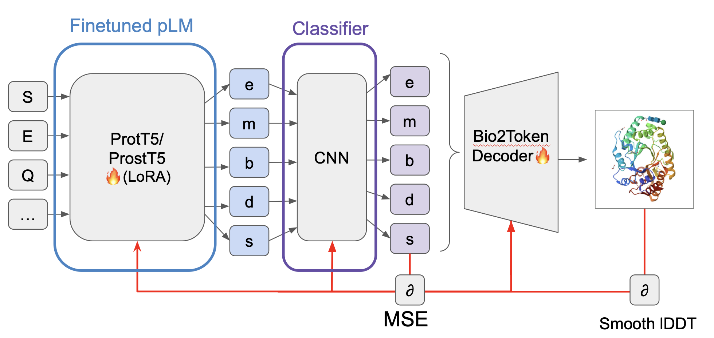
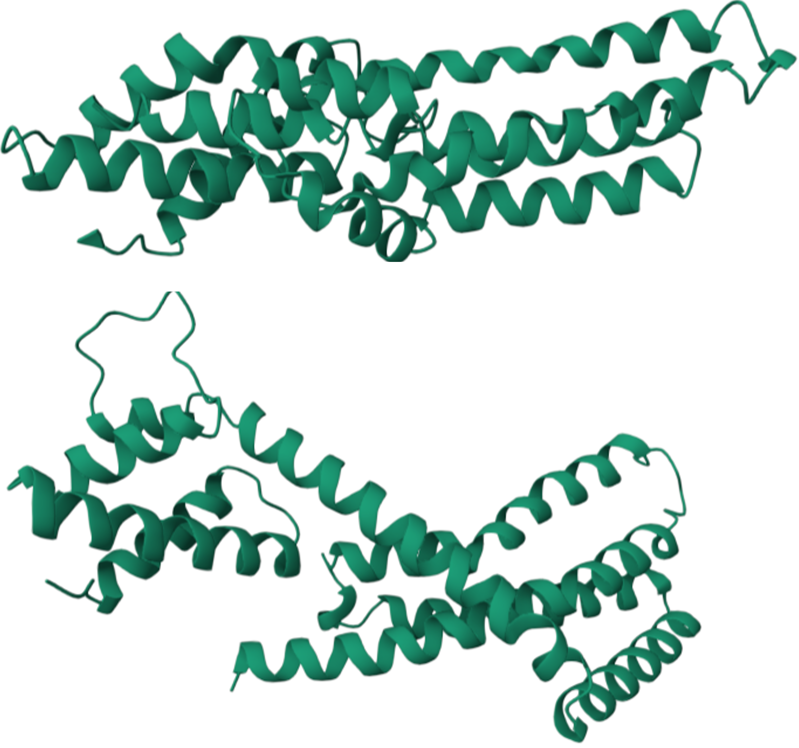

# ProFold: End-to-End Monomer Structure Prediction via Structure Tokenization

A PyTorch-based, end-to-end differentiable framework for high-throughput protein structure prediction. ProFold leverages pretrained protein language models (pLMs), a custom Convolutional Neural Network (CNN) projection head, and the Bio2Token structure decoder to predict 3D atomic coordinates directly from amino acid sequences.

## The Core Concept

While state-of-the-art models like AlphaFold rely on computationally expensive Multiple Sequence Alignments (MSAs), and pLM-based approaches like ESMFold often struggle with inference speed at scale, **ProFold** offers a highly scalable alternative. 

By eliminating non-differentiable vector quantization steps, ProFold enables seamless gradient flow from the amino acid sequence to 3D coordinates.


*(Figure 1: End-to-end architecture of ProFold. Sequences are encoded by ProtT5/ProstT5, processed by a CNN head into continuous latent vectors, and decoded directly into 3D coordinates.)*

### Architecture Details
1. **Sequence Encoder:** Pretrained pLMs (`ProtT5` or `ProstT5`) generating per-residue embeddings. Fine-tuned via LoRA adapters.
2. **CNN Projection Head:** A deep residual 1D-CNN (`FinalResidueTokenCNN`) mapping embeddings to continuous latent vectors without discrete quantization.
3. **Structure Decoder:** The `Bio2Token` decoder, acting as a fully differentiable function to map latents directly to Cα-coordinates.

## Performance & Benchmarks

ProFold was trained on ~75,000 proteins (Cα-only resolution) optimizing for a combined Smooth lDDT, FAPE, and MSE loss. 

* **Inference Speed:** ProFold achieves a **~100x speedup** compared to ESMFold. Predicting the structures of 95 CASP15 proteins on an NVIDIA H100 GPU takes just **2 seconds** (compared to ~200 seconds for ESMFold).
* **Accuracy:** Attains an average lDDT of 0.67 on ProstT5 test data and 0.64 on CASP15 free-modeling targets. It captures local structural elements (secondary structures, loops) with high fidelity.


*(Figure 2: Comparison of predicted (top) and experimental (bottom) Cα coordinates. Local secondary structures are captured with high accuracy.)*

## Setup & Usage

- This project uses a modified version of the [PyTorch Container from the NGC Catalog](https://catalog.ngc.nvidia.com/orgs/nvidia/containers/pytorch).
- The modified container is stored in our group directory at `container/mapra_container.sqsh`.
- To use it, you need to enter the container:

    ```bash
    # Create a new container from the current sqsh file
    # (This can be skipped if the container already exists)
    enroot create --name updated_container container/mapra_container.sqsh
  
    # Start the container
    enroot start updated_container
  
    # Run the training script 
    bash train_scripts/train_c_alpha_res_cnn.sbatch
    
    # Exit the container when finished
    exit
    ```
